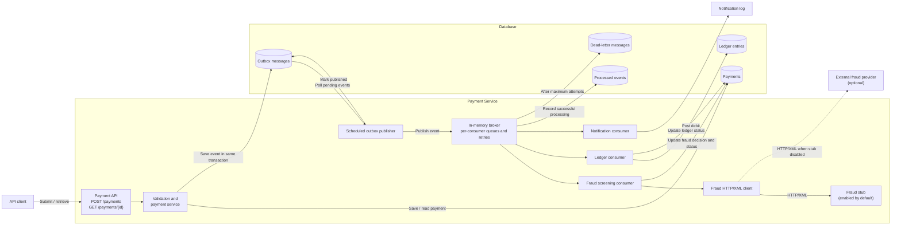

# Payment Service

This spring boot service accepts payment submissions, persists them, reliably publishes `PaymentSubmitted` events via a **transactional outbox**, and processes them with three isolated consumers (notification, fraud screening, ledger).

## High-level architecture



The API returns after saving the payment and outbox event; the three consumers run asynchronously and independently. In particular, ledger posting does **not** wait for fraud approval, so a declined payment may still have `ledgerPosted: true`.

## Architecture choices

### Transactional outbox
`POST /payments` writes the `payments` row and a `outbox_messages` row in the **same database transaction**. A scheduled `OutboxPublisher` polls `PENDING` outbox rows and publishes to an in-process broker stub, then marks them `PUBLISHED`.

- Survives process restarts: unpublished rows remain `PENDING`.
- Survives temporary broker failures: publish errors leave the row pending for the next poll.
- Consumers are designed to handle duplicate deliveries, but the in-memory broker does not guarantee delivery across restarts.

### In-process broker stub
`InMemoryMessageBroker` fans each event out to **per-consumer queues** with concurrent workers, exponential backoff retries, and a durable `dead_letter_messages` table after max attempts. One failing/slow consumer does not block the others.

The broker queues and scheduled retries are in memory. A restart can lose queued events after the outbox row has been marked `PUBLISHED`; the durable outbox alone does not provide end-to-end delivery guarantees with this stub.

Swap `payment.fraud.base-url` (and disable the stub) to point at a real fraud provider without changing payment API code. Replacing the in-process broker with Kafka/RabbitMQ would keep the outbox and consumer contracts intact.

### Consumers
| Consumer | Behavior | Idempotency |
|---|---|---|
| **Notification** | Always healthy; logs a side-effect stub | `processed_events` key `(consumer, eventId)` |
| **Fraud Screening** | Calls XML-over-HTTP vendor API; records decision on the payment | Skips if decision already present + processed-event key |
| **Ledger** | Posts a debit | Unique `ledger_entries.payment_id` + processed-event key |

### Fraud screening stub
Enabled by default (`payment.fraud.enabled-stub=true`) at `POST /screening/v2/check`.

- Responses are classpath fixtures selected by payment amount:
  - amount `< risk-amount-threshold` → `screening_api_response.xml` (ACCEPT)
  - amount `>= risk-amount-threshold` → `screening_api_risk_response.xml` (DECLINE)
  - amount `>= failure-amount-threshold` → `screening_api_failure_response.xml` (HTTP 500)
- Tunables: `fraud-stub.risk-amount-threshold`, `failure-amount-threshold`, `min/max-latency-ms`

### OpenAPI + codegen
Specs live in `openapi/`:

- `payment-api.yaml` → Spring interface + models (`PaymentsApi`) via OpenAPI Generator 5.4 (Java 8 compatible)
- `fraud-screening-api.yaml` → generated RestTemplate XML client (`FraudScreeningApi`) + models

Business logic lives in hand-written components (`PaymentService`, consumers, `OpenApiFraudScreeningClient` adapter). Controllers implement generated payment API interfaces.

### Kubernetes / CI
- Multi-stage **Dockerfile**, non-root UID `10001`
- **Kustomize** under `k8s/`: Deployment (requests/limits, probes), Service, ConfigMap, Secret refs, HPA, PDB, NetworkPolicy, ServiceAccount
- **Jenkinsfile**: build → tests → static analysis → dependency/image scan → image build/push → non-prod deploy → prod promotion with approval

## API

### `POST /payments`
```json
{
  "sourceAccount": { "name": "Alice", "accountNumber": "GB29NWBK60161331926819" },
  "destinationAccount": { "name": "Bob", "accountNumber": "DE89370400440532013000" },
  "amount": 1250.5,
  "currency": "EUR",
  "reference": "Invoice-4421",
  "requestedExecutionDate": "2026-11-20"
}
```

Validates: positive amount, supported currency (`USD`/`EUR`/`GBP`), account number `^[A-Za-z0-9]{8,34}$`, execution date not in the past.

- `201` created
- `400` malformed / bean validation
- `422` business validation

### `GET /payments/{id}`
Returns the payment including `fraudDecision` when screening has completed, and `ledgerPosted`.

## How to run locally

### Prerequisites
- Java 8+
- Maven 3.9+
- Optional: Docker / Docker Compose, kubectl

### Tests
```bash
cd payment-service
mvn test
```

### Run the app
```bash
mvn spring-boot:run
```

App: `http://localhost:8080`  
H2 console: `http://localhost:8080/h2-console` (JDBC URL `jdbc:h2:file:./data/payments`)  
Health: `http://localhost:8080/actuator/health`

Example:
```bash
curl -s -X POST http://localhost:8080/payments \
  -H 'Content-Type: application/json' \
  -d '{
    "sourceAccount":{"name":"Alice","accountNumber":"GB29NWBK60161331926819"},
    "destinationAccount":{"name":"Bob","accountNumber":"DE89370400440532013000"},
    "amount":100.00,
    "currency":"EUR",
    "reference":"demo-1",
    "requestedExecutionDate":"2030-01-15"
  }'
```

### Point at a real fraud provider
```bash
export PAYMENT_FRAUD_BASE_URL=https://fraud.bnk.com
export PAYMENT_FRAUD_ENABLED_STUB=false
mvn spring-boot:run
```

### Docker Compose (optional)
```bash
docker compose up --build
```

### Kubernetes dry-run / apply path
Offline (no cluster): render and inspect with Kustomize:

```bash
kubectl kustomize k8s/
```

With a configured kubeconfig / cluster:

```bash
kubectl apply --dry-run=client -k k8s/
kubectl apply -k k8s/
```

Exact apply path for CI/CD: `kubectl apply -k k8s/` then `kubectl -n payments set image deployment/payment-service payment-service=<image>`.

## Project layout

```
payment-service/
  openapi/                 OpenAPI specs (payment + fraud client)
  src/main/java/...        Domain, outbox, broker, consumers, fraud stub/client, API
  src/test/java/...        Unit + integration tests
  k8s/                     Deployment manifests (Kustomize)
  Dockerfile               Multi-stage, non-root
  docker-compose.yml       Local container run
  Jenkinsfile              Declarative CI/CD
```

## Configuration reference

| Property | Default | Purpose |
|---|---|---|
| `payment.supported-currencies` | `USD,EUR,GBP` | Allowed currencies |
| `payment.outbox.poll-interval-ms` | `500` | Outbox poll cadence |
| `payment.messaging.max-attempts` | `5` | Retries before DLQ |
| `payment.fraud.base-url` | `http://localhost:8080` | Fraud provider base URL |
| `payment.fraud.enabled-stub` | `true` | In-process vendor stub |
| `fraud-stub.risk-amount-threshold` | `1000` | Amounts at/above return DECLINE fixture |
| `fraud-stub.failure-amount-threshold` | `5000` | Amounts at/above return FAILURE fixture (HTTP 500) |
